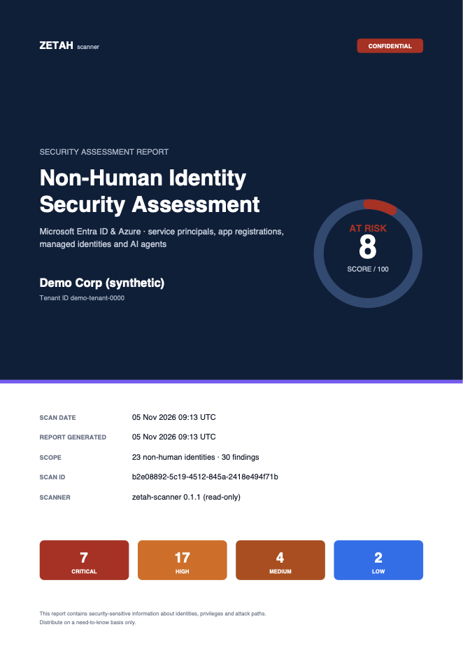
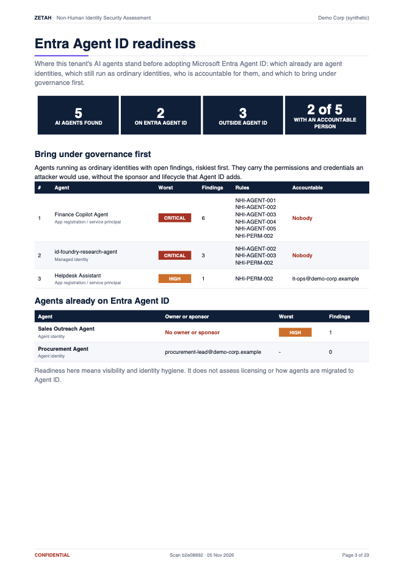

# zetah-scanner

[](https://github.com/Fabriics/zetah-scanner/actions/workflows/tests.yml)
[](LICENSE)


**A free, read-only Entra Agent ID readiness check for Microsoft Entra ID.** Find the AI agents and other
non-human identities already living in your tenant, see who is accountable for each, and know which
ones to bring under governance first.

Microsoft Entra Agent ID gives agents a proper identity and a sponsor. The agents built before it are
still there: app registrations from pilots, reused managed identities, client secrets valid for years,
tenant-wide Microsoft Graph permissions, often nobody accountable. `zetah-scanner` reads your tenant,
inventories every non-human identity (Agent ID agents included) and reports the combinations that turn
one compromised agent or app into a tenant-wide incident.

- **Read-only.** It only issues `GET` requests to Microsoft Graph and Azure Resource Manager, and a test
  fails the build if any other kind of request appears in the code. Suggested commands are printed,
  never run.
- **Local.** Results stay on your machine. There is no telemetry and nothing is sent anywhere.
- **Explainable.** Every finding comes with evidence, the attack path it opens, and suggested commands.
  Review them before running them: they change a live tenant, and steps that could break a running workload
  are commented out on purpose.



## Try it in one minute (no tenant needed)

```bash
git clone https://github.com/Fabriics/zetah-scanner && cd zetah-scanner
python3 -m venv .venv && .venv/bin/pip install -r requirements.txt
.venv/bin/python -m src.nhi_scanner.cli --demo --pdf report.pdf
```

On Windows, use `.venv\Scripts\pip` and `.venv\Scripts\python`.

`--demo` scans a synthetic tenant (23 identities, 5 AI agents, 30 findings) through exactly the same
code path as a live scan. The output is in [`examples/`](examples/): a PDF report and the JSON payload.

## Entra Agent ID readiness

The report opens with where your AI agents stand:

- how many AI agents exist, how many already are **Entra Agent ID** identities and how many still run as
  ordinary app registrations, service principals or managed identities;
- who is accountable for each: an owner or, for Agent ID agents, a **sponsor**;
- the agents outside Agent ID to **bring under governance first**, riskiest first.



Agent identities are read from `GET /servicePrincipals/microsoft.graph.agentIdentity` and recognised by
their type (`#microsoft.graph.agentIdentity`, `servicePrincipalType: ServiceIdentity`); agent identity
blueprint principals are recognised too. Agents that are not Agent ID objects are classified as AI agents
from tags and naming patterns, and the matched signals are kept in each entity's
`raw_metadata.agent_classification_signals`.

Sponsors count as owners for the "orphaned AI agent" check. Microsoft currently documents a ReadWrite
permission for reading sponsors; when the scanner cannot read them it says so and reports those agents
as "unknown", not orphaned. Agent ID APIs are new: this support follows the Microsoft Learn documentation
of November 2026. Please open an issue if the API behaves differently in your tenant.

## Scan your tenant

```bash
az login   # or any credential DefaultAzureCredential understands: env vars, workload identity, managed identity
.venv/bin/python -m src.nhi_scanner.cli --tenant-id <TENANT_GUID> --pdf report.pdf --json scan.json
```

With `az login` the access token carries your own rights, even though the scanner only reads. To have
Microsoft enforce read-only as well, run it with a dedicated app registration that holds only the read
permissions below.

Microsoft Graph **read** permissions for the scanning identity (application or delegated):

| Permission | Used for |
|---|---|
| `Application.Read.All` | app registrations, service principals, their credentials (secrets, certificates and federated credentials), owners, descriptions and notes |
| `Directory.Read.All` | directory objects, the delegated permissions consented to each app (`oauth2PermissionGrants`), and the name of consenting users who hold an Entra role |
| `RoleManagement.Read.Directory` | Entra roles held by service principals, and by users who consented to an app |
| `AuditLog.Read.All` (+ Entra ID P1) | last sign-in of each service principal (dormancy rules; they are skipped when the report is unavailable or empty) |
| `AgentIdentity.Read.All` | Entra Agent ID agent identities |

Plus Azure `Reader` at root or management-group scope for the Azure RBAC rules, for the federated credentials
of user-assigned managed identities, and for Azure OpenAI and AI Services accounts. Account keys are never
listed: listing them is an action, and the scanner only reads. App registrations and
service principals are required. Anything else the identity cannot read is reported as a warning and the
affected rules are skipped, never guessed.

| Flag | Purpose |
|---|---|
| `--demo` | scan the synthetic tenant `demo-tenant-0000` |
| `--pdf PATH` | write the PDF report |
| `--json PATH` | write the validated JSON payload |
| `--skip-azure-rbac` | Entra only |
| `--dormant-days N` | dormancy threshold (default 90) |
| `--fail-on SEVERITY` | exit code 2 if a finding at or above SEVERITY exists (CI gating) |

## What it checks

| Rule | Detects | OWASP |
|---|---|---|
| NHI-SEC-001 | expired secrets or certificates still attached | NHI1 |
| NHI-SEC-002 | client secrets valid for more than 365 days | NHI7 |
| NHI-SEC-003 | multiple active client secrets on one app | NHI2 |
| NHI-SEC-004 | credentials added on the service principal object (critical on Microsoft first-party apps, except hybrid Exchange, SharePoint or Skype certificates, which are flagged for review) | NHI3 |
| NHI-SEC-005 | all credentials expire within 30 days, no replacement in place | — |
| NHI-SEC-007 | Azure OpenAI or AI Services account that still accepts static API keys (high when reachable from the internet), with the non-human identities whose roles can list those keys | NHI4, NHI7, ASI03 |
| NHI-SEC-006 | GitHub Actions federated credential bound too loosely: any pull request, a whole repository, a non-main branch, tags, an environment whose protection is not visible, or a flexible credential; raised one level on privileged identities | NHI6 |
| NHI-DORM-001 | no sign-in for N days, but valid credentials | NHI1 |
| NHI-DORM-002 | never signed in, but valid credentials | NHI1 |
| NHI-PERM-001 | Graph permissions that allow tenant takeover | NHI5 |
| NHI-PERM-002 | tenant-wide data access (mail, files, chats...) | NHI5 |
| NHI-PERM-003 | privileged Entra directory roles | NHI5 |
| NHI-RBAC-001 | Owner / User Access Administrator / RBAC Administrator in Azure | NHI5 |
| NHI-RBAC-002 | Contributor at subscription or management-group scope | NHI5 |
| NHI-AGENT-001 | AI agent with no owner and no sponsor | NHI1 |
| NHI-AGENT-002 | AI agent with tenant-wide permissions to act (send, write, change) | NHI5, ASI03 |
| NHI-AGENT-003 | AI agent that can read data and send it out: an exfiltration path | NHI5, ASI02 |
| NHI-AGENT-004 | AI agent authenticating with static client secrets | NHI2, ASI03 |
| NHI-AGENT-005 | multi-tenant AI agent app | NHI9, ASI04 |
| NHI-AGENT-006 | AI client whose delegated consents let it read users' data and send it out (mail, chat) | NHI5, ASI01, ASI02 |
| NHI-AGENT-008 | AI client with `offline_access` on mail, files, chats or write scopes: it keeps acting for users while they are offline | NHI7, ASI03 |

The OWASP column names the entries of the [OWASP Top 10 Non-Human Identities Risks 2025](https://owasp.org/www-project-non-human-identities-top-10/2025/) (NHI1-NHI10) and of the
[OWASP Top 10 for Agentic Applications 2026](https://genai.owasp.org/resource/owasp-top-10-for-agentic-applications-for-2026/) (ASI01-ASI10) that each finding
is an instance of. Every finding carries them in the `owasp` field of the JSON payload, and the PDF shows them.
NHI-SEC-005 names none: an outage caused by expiring credentials is not one of the listed risks.

NHI-AGENT-006 and NHI-AGENT-008 go up one level when a user who consented holds a privileged Entra role across the
tenant: for that user, the agent acts with administrator rights.

Findings are scored into a 0-100 hygiene score; the PDF explains the scoring and the limitations.

## Identity record

Besides app registrations, service principals, managed identities and AI agents, the inventory has one more kind of
non-human identity: `api_key`, the static keys of an Azure OpenAI or AI Services account. Whoever holds them calls
the models, with no identity behind the call.

Findings are the judgment; the identity record is the fact. Every identity in the JSON payload carries a
`record`, clean identities included, with everything the scan read about it:

| Section | Content |
|---|---|
| `profile` | description, notes, sign-in audience, publisher domain |
| `owners`, `sponsors` | each accountable object, whether it is a user or a service principal, whether its account is enabled, and where it is set |
| `credentials` | every secret and certificate: key ID, type, name, validity dates, and whether it sits on the app registration or on the service principal (metadata only: secret values are never read) |
| `federated_credentials` | every trust in an external identity provider (GitHub Actions, Kubernetes, other clouds): issuer, subject, audiences, and whether it sits on the app registration or on a user-assigned managed identity |
| `graph_permissions` | application permissions on Microsoft Graph |
| `delegated_permissions` | delegated permissions (scopes) consented to the app, per API: for all users by an administrator, or by how many users for themselves |
| `directory_roles` | Entra roles assigned directly, with their scope |
| `azure_roles` | Azure RBAC roles, with their scope |
| `activity` | last sign-in |

Each section states the reads it comes from (`sources`), when they finished (`read_at`) and its `status`:
`read`, `not_read` (the scan could not read it: unknown, not empty) or `not_applicable`. A `note` says
what the section does not cover yet. The record is new in contract version 2
(`metadata.contract_version`); payloads written by 0.1.x are version 1 and still validate.

## Limitations

- Point-in-time scan; identities and permissions change continuously. A clean result covers only the
  checks listed above: it does not prove that an identity is harmless.
- Only application permissions on Microsoft Graph are evaluated. Permissions on other APIs, such as
  Exchange Online `full_access_as_app` or SharePoint Online, are not read yet.
- Entra roles held through role-assignable groups, Azure roles held through groups, and custom Azure
  roles equivalent to Owner or Contributor are not evaluated yet.
- Delegated permissions are read as consents. They act within each signed-in user's own access, which is
  not evaluated, and only consents to AI agents are judged by the checks.
- Federated credentials are judged for GitHub Actions only, and GitHub's own branch and environment
  protection is not read. Flexible federated credentials are read through Graph v1.0, which does not return their
  matching expression. App registrations are read one by one, so large tenants take longer.
- Azure AI account keys are judged by whether they are accepted, not by their age or use: key values, creation
  dates and diagnostic logs are not read. Who can list them is computed from the built-in roles that allow it;
  custom roles are not evaluated.
- Identities outside Microsoft (GitHub, AWS, MCP servers, other LLM provider keys) are not covered yet.
- AI agents that are not Entra Agent ID objects are found with heuristics. Generic names such as "agent"
  or "bot" count only next to an AI term, so unlabelled agents may be missing.
- An app registration and its service principal are separate objects in Entra and are listed as two
  identities, so identity counts are higher than the number of applications.
- Dormancy uses sign-in activity per application, not per credential.
- Only the Microsoft global cloud is supported.
- Readiness means visibility and identity hygiene; licensing and migration tooling are out of scope.

## Roadmap

Keys of other LLM providers,
workload exposure, and agents on non-Microsoft platforms. `zetah-scanner` is the open-source engine of
**Zetah**, which adds continuous monitoring, history and agent governance across platforms.

## For developers

Pipeline: `collector.py` (Graph/ARM) → `snapshot.py` → `inventory.py` (with `record.py`) → `rules.py` → `models.py`
(`ZetahScanPayload`, validated with Pydantic) → JSON / PDF; `readiness.py` derives the Agent ID view
from the payload. Each rule emits at most one finding per identity, so
`finding_id = sha256(tenant_id + entity_id + rule_id)` is stable across scans. `--schema-out PATH`
writes the payload JSON Schema.

```bash
.venv/bin/pip install -r requirements-dev.txt && .venv/bin/python -m pytest -q
```

Tested with Python 3.13 and 3.14. Dependencies are pinned to exact versions.

## Contributing and security

Issues and pull requests are welcome. Please report vulnerabilities privately, as described in
[SECURITY.md](SECURITY.md), not in public issues.

## License and trademarks

Apache License 2.0, see [LICENSE](LICENSE). This is an independent project, not affiliated with or
endorsed by Microsoft. Microsoft, Microsoft Entra and Azure are trademarks of the Microsoft group of
companies.
